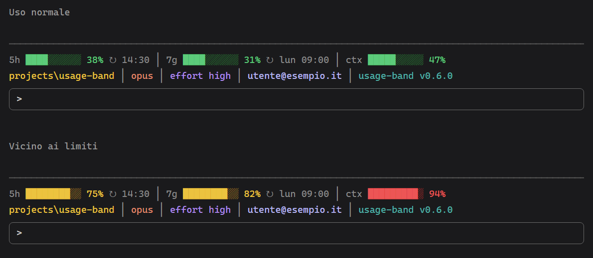

# Changelog

Formato basato su [Keep a Changelog](https://keepachangelog.com/it/1.1.0/).

## [0.17.4] - 2026-10-28

### Corretto
- Dopo una compattazione, un turno senza testo (la notifica di un agente in background) o un prompt che parte prima di comparire tra i messaggi non porta più `ctx` a n/d: un messaggio solo nella conversazione vale come «conversazione vuota» solo se è il prompt nuovo, non il riassunto.
- Dopo un rewind all'inizio col doppio Esc, `ctx` resta n/d anche se il turno del prompt nuovo parte prima che il prompt compaia tra i messaggi.
- Se una risposta porta la percentuale del contesto proprio mentre la stima dopo una compattazione la sta controllando, la stima non la sovrascrive più: alla compattazione successiva vale l'ultima cifra vera.
- Se il salvataggio della stima non riesce, dopo un rewind all'inizio `ctx` resta n/d invece di tornare alla cifra di prima del rewind.

## [0.17.3] - 2026-10-22

### Corretto
- Anche per 5h e 7g colore e barra seguono la percentuale arrotondata dell'etichetta: un 89,6% appare come «90%» in rosso, non più in giallo.
- Se una risposta porta la percentuale mentre è ancora in corso la stima del contesto dopo una compattazione, la stima viene scartata: alla compattazione successiva `ctx` non mostra più quella cifra superata al posto dell'ultima vera.
- Un ridisegno in cui Claude Code non fornisce i dati non riporta più `ctx` alla cifra di prima della compattazione.
- Dopo un rewind fino all'inizio della conversazione `ctx` mostra n/d anche durante il turno che segue, fino alla prima risposta, invece della cifra di prima del rewind. Vale anche col doppio Esc, che non ridisegna la barra: lì n/d compare dal prompt successivo.
- In una sessione che non ha ancora avuto una percentuale del contesto la barra non legge più tutti i messaggi a ogni ridisegno (ogni secondo durante il countdown della cache).

## [0.17.2] - 2026-10-22

### Corretto
- Dopo una compattazione la voce `ctx` mostra il contesto rimasto, contato dai messaggi come fa `/context`, anche dopo una seconda `/compact` di fila. Dopo una compattazione automatica a metà turno si aggiorna alla prima risposta che segue, non più solo a fine turno.
- Durante un turno `ctx` segue la percentuale di ogni risposta del modello, non solo quella di fine turno.
- Dopo un rewind, con `/rewind` o con doppio Esc, `ctx` mostra il contesto del punto scelto, che Claude Code ripristina da sé. Col doppio Esc compare al ridisegno successivo della barra. Tornando all'inizio della conversazione mostra n/d.
- Se il conteggio dei token non riesce, `ctx` mostra n/d invece della cifra di prima della compattazione.
- Una stima che arriva dopo `/clear` o `/resume` non passa più alla sessione nuova.
- La percentuale stimata è intera, così colore ed etichetta seguono la stessa soglia (prima un 89,6% appariva come «90%» ma giallo).
- A ogni compattazione non compare più l'avviso «its session.compact hook was skipped»: il mod non registra più l'hook `session.compact`, che il plugin gestito `cc-plugin-sec-default` saltava sempre. Dove quel plugin è attivo i token del riassunto non entravano già nel conteggio `tkn`; senza, da questa versione `tkn` non li conta più, mentre il costo li include ancora.

## [0.17.1] - 2026-10-22

### Corretto
- Dopo `/compact`, `/rewind` e una compattazione automatica la voce `ctx` mostra subito il contesto rimasto, contato come fa `/context`, invece del valore di prima fino alla risposta successiva; una misura che aggiorna solo i limiti 5h/7g non lo riporta indietro.

## [0.17.0] - 2026-10-22

### Modificato
- Un clic sul modello o sull'effort esegue di nuovo `/model` o `/effort`, che aprono la schermata di scelta di Claude Code, al posto del pannello del mod; la bozza nel prompt resta intatta e, finito il comando, la barra mostra l'effort in vigore (anche dopo un cambio di modello). Se il comando non può partire compare un avviso.

### Rimosso
- I pannelli di scelta del modello e dell'effort introdotti nella 0.16.0.

## [0.16.1] - 2026-10-21

### Corretto
- L'effort compare subito in una sessione nuova, dopo `/clear` e dopo `/resume`, senza attendere il primo prompt: viene dalle impostazioni salvate da `/effort` per il modello in uso, e la prima richiesta al modello lo conferma o lo corregge.

## [0.16.0] - 2026-10-21

### Modificato
- Un clic sul modello o sull'effort apre un pannello con la lista delle scelte, una per riga, invece di eseguire `/model` o `/effort`. Si sceglie con il tasto numerico della riga, con un clic o con Tab e Invio; la scelta attuale è segnata con ✓; Esc chiude. Il pannello compare sopra il prompt, oppure a lato della conversazione a schermo intero.
- Il modello si cambia come dalla riga Model di `/config`, senza comandi nella conversazione. L'effort, che non ha una riga in `/config`, si cambia con `/effort <livello>`, che lascia una riga nella conversazione; finito il comando, la barra mostra subito il livello in vigore, letto dalle impostazioni dove `/effort` lo salva (un livello che il modello non ha lascia quello di prima); `max`, che `/effort` applica solo alla sessione senza salvarlo, compare così com'è. Vale anche per un `/effort <livello>` scritto a mano.

### Corretto
- Dopo `/clear`, `/resume` o un fork la rilettura di consumi, versione ed email parte a disegno finito: il motore rifiuta le scritture di stato fatte durante il disegno della barra, e i valori nuovi potevano non arrivare.

## [0.15.0] - 2026-10-21

### Aggiunto
- Un clic sul nome del modello esegue `/model`, un clic sull'effort esegue `/effort`, come se fossero stati digitati; la bozza nel prompt resta intatta. Se il comando non può partire compare un avviso.

## [0.14.3] - 2026-10-21

### Corretto
- Il mod e i suoi test passano il controllo dei tipi di TypeScript (`tsc`) senza errori; nessun cambiamento nel funzionamento.

## [0.14.2] - 2026-10-21

### Corretto
- Niente più avvisi `usage-band: its … hook was skipped` all'avvio e durante la sessione: il mod non ascolta più gli eventi classici (`SessionStart`, `Stop`, `PreModelSwitch`, `PostModelSwitch`) né `prompt.context`, che un plugin gestito come `cc-plugin-sec-default` può scavalcare.

### Modificato
- Dopo `/clear`, `/resume` o un fork la barra rilegge consumi, versione ed email al primo disegno della sessione nuova, invece che dall'evento classico `SessionStart`: funziona anche dove quell'evento viene scavalcato. Finché la lettura non arriva, 5h e 7g sono quelli che il motore conosce già.
- Se `claude auth status` non risponde, l'email viene dal file di configurazione di Claude Code (`.claude.json`) invece che dal contesto del primo messaggio.
- All'avvio un errore nella lettura dei consumi non impedisce più a versione ed email di comparire.
- L'effort viene solo dalle richieste al modello (`turn.step`), che lo riportano già.

### Rimosso
- La durata della cache presa dal cambio di modello: viene da `FORCE_PROMPT_CACHING_5M` / `ENABLE_PROMPT_CACHING_1H`, altrimenti vale un'ora.

## [0.14.1] - 2026-10-21

### Modificato
- `cache scaduta` è in rosso invece che attenuata, così la scadenza si nota a colpo d'occhio.

## [0.14.0] - 2026-10-21

### Aggiunto
- Un clic su `ctx` scrive nel prompt, senza inviarla, la richiesta di valutare `/compact` con la percentuale di contesto attuale: Claude indica se serve, con cosa mantenere e cosa pulire, e salva in memoria o nello scratchpad ciò che gli serve per proseguire. Il testo viene scritto solo se il prompt è vuoto; altrimenti compare un avviso e la bozza resta com'è. Con il contesto `n/d` la voce non è cliccabile.

## [0.13.0] - 2026-10-21

### Aggiunto
- Dopo `/resume` (o `claude --resume`, o un fork) la barra mostra subito il tempo che resta alla cache del prompt, contato dall'ultima risposta del thread principale letta dal transcript della conversazione ripresa, invece di restare `n/d` fino al prompt successivo. Funziona anche con le chat già fatte e non dipende dagli eventi classici, che un plugin gestito può scavalcare. Un transcript oltre i 4 MiB si legge solo nelle ultime righe.
- Se lo stato del mod è vuoto (ad esempio dopo `/resume`, o perché un altro plugin scavalca l'evento di avvio), la percentuale di contesto viene letta direttamente dal motore.

### Modificato
- Dopo `/resume` o un fork la barra riprende anche 5h, 7g, versione ed email, come dopo `/clear`, quando l'evento di avvio arriva al mod.

## [0.12.0] - 2026-10-17

### Aggiunto
- Il costo dell'intera sessione in dollari, subito a destra di `tkn` e in rosa (`$12.30`), senza etichetta e non cliccabile. È il conto di Claude Code (lo stesso di `/cost`, a prezzo di listino): dopo `--continue` o `--resume` comprende anche il lavoro precedente, `/clear` lo azzera. Compare dalla prima richiesta pagata e solo dove il motore tiene il conto.

## [0.11.2] - 2026-10-17

### Corretto
- I token e il costo dell'operazione contano anche le skill e i comandi slash che avviano un turno del modello: prima venivano scartati e, se una sessione partiva da una skill, la voce `tkn` non compariva finché non si scriveva un prompt normale. I comandi locali (`/clear`, `/usage-band`) continuano a non aprire un'operazione.

## [0.11.1] - 2026-10-15

### Rimosso
- Il segno ` (P)` accanto al modello con `opusplan`: dipendeva da `settings.json` e `ANTHROPIC_MODEL` e compariva anche con un altro modello scelto con `--model` all'avvio, che il mod non vede. La barra mostra il modello in uso al momento. Soluzione da studiare in `TODO.md`.

## [0.11.0] - 2026-10-15

### Aggiunto
- Il costo dell'ultima operazione in dollari, in coda alla voce `tkn` sia compatta sia dettagliata (`tkn 28.7k · $0.54`). È la crescita del costo della sessione calcolato da Claude Code (lo stesso di `/cost`, a prezzo di listino) da quando è iniziato il prompt: comprende subagenti e compattazione e usa i prezzi giusti per ogni modello. Con un abbonamento è un valore indicativo. Sotto il centesimo compare `<$0.01`.
- Nel dettaglio, dopo i token letti dalla cache, la quota dell'ingresso servita dalla cache (`♺ 939.6k 97%`): un valore basso segnala una cache scaduta o invalidata.

### Modificato
- Il totale compatto conta solo i token nuovi, ingresso e uscita: le letture dalla cache costano una frazione di un token normale e sommate alla pari gonfiavano il numero di circa nove volte. Restano nel dettaglio (`♺`).
- Il README descrive la cache e i token e mostra la versione nel formato `vX.Y.Z`.

## [0.10.1] - 2026-10-15

### Corretto
- Con `opusplan` in plan mode, durante il turno la barra mostra `Opus 5.5 (P)` invece di `Sonnet 5.5 (P)`. Mentre Claude lavora la barra mostra il modello dell'ultima richiesta del thread principale, scelto dal motore a ogni richiesta; a turno finito torna il modello della sessione. Da fermo in plan mode resta il modello della sessione finché non parte la prima richiesta, perché il mod non conosce la modalità in uso.

## [0.10.0] - 2026-10-15

### Aggiunto
- Con il modello `opusplan` (Opus in plan mode, Sonnet altrimenti) il nome del modello effettivo è seguito da ` (P)`, ad esempio `Sonnet 5.5 (P)`. La scelta viene dall'ultimo cambio di modello nella sessione (`/model`, selettore, SDK, ripresa), altrimenti da `ANTHROPIC_MODEL`, altrimenti dal campo `model` delle impostazioni; un avvio con `--model opusplan` non è visibile al mod finché non si cambia modello nella sessione.

## [0.9.0] - 2026-10-15

### Aggiunto
- A sinistra della cartella, i token dell'ultima operazione: l'ultimo prompt con tutte le richieste in cui si spezza, i subagenti che lancia (anche annidati) e l'eventuale compattazione. Il numero cresce in diretta mentre Claude lavora. Formato compatto (predefinito) col solo totale (`tkn 245.3k`); un clic sull'intera voce passa al dettaglio (`tkn ↑12.4k ↓1.8k ♺ 231.1k (∴8.1k)`: ingresso, che comprende anche i token scritti in cache, uscita, letti dalla cache e, tra parentesi, la parte dei subagenti, già inclusa negli altri) e viceversa. Un subagente conta per l'operazione in corso quando apre il suo turno, anche se il mod non ne ha visto la creazione. Solo un prompt scritto dalla persona (terminale, Remote Control o SDK, esclusi i comandi slash) azzera il conteggio: le notifiche dei subagenti in background e le altre ripartenze continuano l'operazione, e i subagenti di un'operazione precedente non toccano quella nuova. `♺` somma le letture dalla cache di ogni richiesta dell'operazione: ogni richiesta rilegge il contesto, quindi cresce in fretta. La voce si nasconde col pulsante `[◂]` insieme agli altri dettagli e resta dopo `/clear`.

## [0.8.0] - 2026-10-15

### Aggiunto
- Dopo ctx, prima del pulsante, il tempo residuo della cache del prompt: in minuti (`cache 42m`) finché mancano più di 10 minuti, poi in minuti e secondi (`cache 9:58`); `cache scaduta` allo scadere e `cache n/d` prima della prima richiesta. Il countdown riparte a ogni richiesta del thread principale (non a quelle dei subagenti), è verde, giallo sotto il 25% della durata e rosso sotto il 10%. La durata viene dal motore al cambio di modello, altrimenti da `FORCE_PROMPT_CACHING_5M` / `ENABLE_PROMPT_CACHING_1H`, altrimenti vale un'ora; con `DISABLE_PROMPT_CACHING` la voce non compare.

### Modificato
- La versione del mod compare da sola (`v0.8.0`), senza il nome `usage-band`.

## [0.7.0] - 2026-10-14

### Aggiunto
- Subito dopo ctx, separato da una pipe, un pulsante cliccabile `[◂]` nasconde cartella, modello, effort, email e versione lasciando solo i consumi; `[▸]` li rimostra. Sta dopo il contesto, così non si sposta quando la riga dell'ambiente compare o sparisce. La scelta vale per la sessione e resta dopo `/clear`.

### Modificato
- Il modello compare col nome leggibile (`Opus 5.5`) invece dell'ID (`claude-opus-5-5`); gestisce anche gli ID datati, il vecchio schema (`claude-3-5-sonnet` → `Sonnet 3.5`), gli alias (`opus` → `Opus`) e il contesto esteso (`[1m]` → `(1M)`). Un ID non riconosciuto resta com'è.
- L'effort mostra solo il livello (`high`), senza la parola `effort`.
- L'illustrazione `docs/usage-band.png` mostra nome del modello, effort, pulsante, barra con dettagli nascosti e la versione 0.7.0.

## [0.6.0] - 2026-10-14

### Modificato
- La barra è separata meglio dalla chat: sopra c'è una riga vuota e una linea tenue (`─`) larga quanto la barra.
- L'illustrazione `docs/usage-band.png` mostra la linea separatrice e la versione 0.6.0.

### Corretto
- Il test dell'orario di reset falliva quando il reset di esempio non cadeva oggi: ora accetta anche il giorno davanti all'orario.

## [0.5.2] - 2026-10-14

### Corretto
- Dopo `/clear` la barra perdeva i consumi di 5h e 7g (n/d), l'email dell'account e la versione del mod: lo stato del mod è per sessione e `/clear` ne apre una nuova senza rifare `session.start`. Ora la barra, quando lo stato è vuoto, mostra gli ultimi 5h/7g, email e versione visti nel processo; in più l'evento classico `SessionStart` con `source: 'clear'`, dove gira, rilegge consumi, versione ed email.

## [0.5.1] - 2026-10-13

### Corretto
- L'effort non compariva in una sessione reale: oltre a `turn.step`, ora si legge anche dall'evento classico `Stop`, che a fine turno porta l'effort applicato (`effort.level`). I turni dei subagenti non lo cambiano.

### Modificato
- L'illustrazione `docs/usage-band.png` mostra la versione 0.5.1.

## [0.5.0] - 2026-10-13

### Aggiunto
- Dopo il modello compare l'effort in uso (`effort high`, in viola), prima dell'email. Si legge dalle richieste del loop principale (evento `turn.step`), quindi è noto dopo il primo prompt e non cambia per le richieste dei subagenti. Con un modello senza effort la voce non compare.

### Modificato
- L'illustrazione `docs/usage-band.png` mostra l'effort e la versione 0.5.0.

## [0.4.0] - 2026-10-13

### Modificato
- In fondo alla barra la versione mostrata è quella del mod (`usage-band v0.4.0`, letta dal suo `plugin.json`) al posto di quella di Claude Code.
- L'email dell'account si ricava all'avvio con `claude auth status`, senza bloccare l'avvio; il blocco `userEmail` del contesto resta come ripiego. Non si forza più il ricalcolo del contesto.
- L'illustrazione `docs/usage-band.png` mostra la versione del mod.

## [0.3.0] - 2026-10-13

### Aggiunto
- In fondo alla barra compaiono il modello in uso (arancio), l'email dell'account (azzurra) e la versione di Claude Code (verde acqua).
- Layout adattivo: su un terminale stretto la barra va su due righe, consumi sopra e ambiente sotto, così la coda non viene tagliata.
- L'email si legge dal blocco `userEmail` del contesto del primo messaggio; all'avvio del mod il contesto viene fatto ricalcolare perché l'email compaia anche a sessione già avviata.

### Modificato
- L'illustrazione `docs/usage-band.png` mostra le due righe con modello, email di esempio e versione.

## [0.2.0] - 2026-10-13

### Modificato
- La barra è sempre visibile, anche prima del primo dato: le voci senza dato mostrano `n/d`.
- Ogni nuova sessione parte con la barra visibile; `/usage-band` la nasconde solo per la sessione corrente.

### Aggiunto
- In coda alla barra compare la cartella di lavoro con la sua cartella padre (per esempio `projects\usage-band`), in giallo.
- Immagine di esempio in `docs/usage-band.png`: è un'illustrazione con valori di esempio, non uno screenshot.

### Corretto
- Spazio tra il simbolo di reset e l'orario o il giorno (`↻ 14:30`, `↻ lun 09:00`).

## [0.1.0] - 2026-10-13

### Aggiunto
- Barra sopra il prompt con percentuale del limite 5h, del limite settimanale e del contesto.
- Colori per soglia (verde, giallo, rosso) e orario di reset per i due limiti.
- Comando `/usage-band` per nascondere e rimostrare la barra.
- Test con `claude plugin test` e marketplace `mavida-mods` per l'installazione con `/plugin install`.
