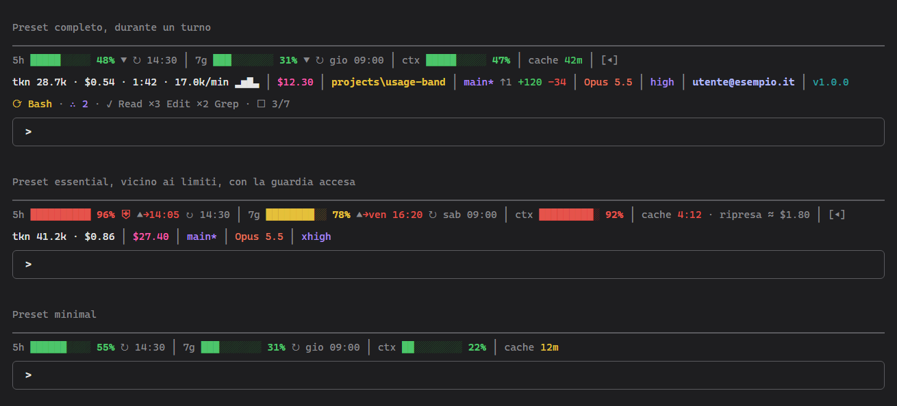

# usage-band

Mod per Claude Code che disegna una barra sopra il prompt con i consumi (limite di 5 ore, limite settimanale, contesto, cache),
il costo dei prompt, lo stato del lavoro e alcune informazioni sull'ambiente:



L'immagine è un'illustrazione con valori di esempio.

## Riga dei consumi

- **5h**: percentuale usata della finestra di limite a 5 ore, con orario di reset.
- **7g**: percentuale usata del limite settimanale, con giorno e orario di reset.
- **ritmo** di 5h e 7g, subito dopo la percentuale: `▲` se il limite si consuma più in fretta del tempo che passa
  nella finestra, `▼` se più lentamente, nulla se il consumo è in linea (entro 5 punti). Se al ritmo medio della finestra
  il limite si esaurirebbe prima del reset, in rosso l'orario previsto: `5h ███████░░░ 72% ▲→16:40 ↻ 17:30`.
  Nel primo 10% della finestra la previsione non compare.
- **ctx**: percentuale di riempimento della finestra di contesto della conversazione.
  Un clic, a prompt vuoto, vi scrive (senza inviarla) la richiesta di valutare `/compact` con la percentuale attuale;
  se il prompt contiene già del testo non lo tocca e mostra un avviso.
- **cache**: tempo che resta prima che scada la cache del prompt, contato dall'ultima richiesta del thread principale:
  in minuti (`cache 42m`) sopra i 10 minuti, poi in minuti e secondi (`cache 9:58`), `cache scaduta` a zero.
  Verde, giallo sotto il 25% della durata, rosso sotto il 10% e quando è scaduta. La durata (5 minuti o 1 ora) viene da
  `FORCE_PROMPT_CACHING_5M` / `ENABLE_PROMPT_CACHING_1H`, altrimenti vale un'ora.
  Dopo `/resume` (o `claude --resume`) ctx e cache compaiono subito: la cache è contata dall'ultima risposta della
  conversazione ripresa, letta dal suo transcript.
- **costo di una ripresa**: quando la cache è gialla, rossa o scaduta, accanto al countdown (`cache 9:58 · ripresa ≈ $1.80`),
  quanto costerebbe la prossima richiesta dovendo riscrivere in cache tutto il contesto. Il prezzo del modello si ricava dalle
  risposte precedenti (aumento del costo della sessione e rapporti di listino tra le voci di prezzo), quindi compare dopo la
  prima risposta del modello e resta noto nelle sessioni successive. Quando la cache entra nel rosso, se la ripresa costerebbe
  almeno $0.50 (soglia in `/config`), arriva un avviso.

I colori seguono il tema: verde sotto il 70%, giallo tra 70% e 90%, rosso da 90% (soglie impostabili in `/config`).
I limiti 5h e settimanale esistono solo con un abbonamento Claude (Pro, Max, Team). Una voce senza dato mostra `n/d`.

## Riga dell'ambiente

- **tkn**: consumo dell'ultimo prompt, con tutte le richieste in cui si spezza e i subagenti che lancia.
  Compatto: token nuovi (ingresso e uscita), costo, durata del prompt, token al minuto e una sparkline del costo degli
  ultimi 8 prompt della sessione (`tkn 28.7k · $0.54 · 1:42 · 17.0k/min ▂▅▇▃`). La durata scorre dal vivo durante il turno e
  comprende i subagenti; la velocità compare dopo 10 secondi; senza costo la sparkline segue i token.
  Un clic sulla voce passa al dettaglio (`tkn ↑27.8k ↓875 ♺ 939.6k 97% (∴37.6k) · $0.54 · 1:42 · 17.0k/min $▂▅▇▃ #▁▃▆▂`):
  ingresso, uscita, letti dalla cache con la quota di riuso, tra parentesi la parte dei subagenti (già compresa negli altri)
  e le sparkline del costo (`$`) e dei token (`#`). Il costo è quello che calcola Claude Code (lo stesso di `/cost`,
  a prezzo di listino): con un abbonamento è indicativo, non una spesa.
- **costo della sessione**: subito a destra di `tkn`, solo il valore in dollari (`$12.30`), in rosa. È il costo dell'intera
  sessione come lo conta Claude Code (lo stesso di `/cost`): dopo `--continue` o `--resume` comprende anche il lavoro precedente,
  `/clear` lo azzera. Non è cliccabile e compare dalla prima richiesta.
- **cartella**: cartella di lavoro con la sua cartella padre, in giallo.
- **git**: il branch (o il commit breve se HEAD è staccato) in viola, con `*` se ci sono modifiche non salvate o file non
  tracciati; `↑1 ↓2` per i commit avanti e indietro rispetto al branch remoto collegato (senza fetch); righe aggiunte (verde)
  e tolte (rosso) rispetto all'ultimo commit: `main* ↑1 ↓2 +120 −34`. Le parti a zero non compaiono, fuori da un repository
  non compare la voce. Si aggiorna all'avvio, a ogni prompt, a fine turno e poco dopo ogni modifica ai file.
- **modello**: il nome leggibile del modello in uso (`Opus 5.5`, non `claude-opus-5-5`), in arancio;
  durante un turno mostra il modello della richiesta in corso (con `opusplan` in plan mode, ad esempio, `Opus 5.5`).
  Un clic esegue `/model`, che apre la schermata di scelta del modello, senza toccare ciò che si sta scrivendo nel prompt.
- **effort**: l'effort in uso, solo il livello (`low`, `medium`, `high`, `xhigh`, `max`), in viola. All'avvio, dopo `/clear` e dopo
  `/resume` viene dalle impostazioni salvate da `/effort` per il modello in uso; poi dalle richieste al modello, che lo
  confermano (e lo tolgono per i modelli senza effort). Un clic esegue `/effort`, che apre la schermata di scelta
  dell'effort; finito il comando, la barra mostra il livello in vigore.
- **email**: l'account corrente, in azzurro, ricavata all'avvio con `claude auth status`
  (serve `claude` nel `PATH`; altrimenti viene dal file di configurazione di Claude Code, `.claude.json`).
- **versione**: versione del mod (`vX.Y.Z`), in verde acqua.

## Riga dell'attività

Durante un turno, sotto la barra, una terza riga mostra cosa sta succedendo: `⟳ Bash · ∴ 2 · ✓ Read ×3 Edit ×2 · ☐ 3/7`.
Sono, in ordine, gli strumenti in corso (in giallo), i subagenti al lavoro (in viola), gli strumenti già usati dal prompt e dai
suoi subagenti (i cinque più usati) e l'avanzamento della lista di attività del modello (TodoWrite o TaskCreate/TaskUpdate).
A turno finito la riga sparisce; c'è solo nel preset `full`.

## Disposizione

Se il terminale è abbastanza largo consumi e ambiente stanno su una riga, altrimenti i consumi restano sulla prima e l'ambiente
va sulla seconda; l'attività, durante un turno, è sempre sotto. Subito dopo la cache, separato da una pipe, un pulsante
(`[◂]`, cliccabile) nasconde ambiente e attività lasciando solo i consumi; `[▸]` li rimostra. La scelta vale per la sessione e
resta dopo `/clear`. La barra è sempre visibile e cede il posto solo ai sondaggi di Claude Code.

## Notifiche

Quando 5h, 7g o ctx passano in giallo o in rosso compare per 10 secondi un toast nel terminale, con un simbolo colorato in testa
(`🟡 Limite 5h al 72%, reset 14:20`, `🔴 Contesto al 92%: valuta /compact`); per il rosso arriva anche la notifica di sistema
(se il terminale la supporta e le notifiche di Claude Code sono attive; su Windows, dove il terminale non ne ha una, arriva
nel centro notifiche di Windows a nome di Windows PowerShell). Per 5h e 7g ogni livello si notifica una volta per finestra,
anche tra sessioni; il contesto avvisa di nuovo se risale dopo una compattazione. Quando la finestra di 5 ore si azzera, se era
almeno gialla, arriva `🟢 Limite 5h azzerato`.

## Guardia

Se attivata in `/config`, quando il limite 5h o settimanale arriva alla soglia della guardia (95%) i subagenti non partono,
anche quelli dei workflow: il modello riceve il motivo con la percentuale e l'orario di reset e prosegue nel thread principale,
a te arriva un toast e accanto al limite compare `⛨`. I prompt passano sempre. Serve a non consumare il resto del limite con
agenti in parallelo.

## Opzioni

In `/config`, alle righe che iniziano con «usage-band:» (una modifica vale subito):

- **preset**: `full` mostra tutte le voci (predefinito); `essential` lascia consumi con ritmo, token, costo della sessione,
  branch git con `*`, modello ed effort; `minimal` solo la riga dei consumi, senza ritmo, costo di ripresa né pulsante `[◂]`.
- **soglia gialla** e **soglia rossa** (70 e 90): colori di 5h, 7g e ctx e notifiche. La gialla deve essere minore della rossa,
  altrimenti valgono 70 e 90.
- **ritmo di consumo**, **notifiche di soglia**, **stato git**, **costo di ripresa**, **attività durante il turno**,
  **durata e andamento dei prompt**: interruttori che spengono la funzione anche nel preset completo.
- **avviso costo di ripresa ($)**: la cifra oltre la quale, con la cache nel rosso, arriva l'avviso (0.50; 0 lo spegne).
- **guardia sui limiti** (spenta) e **soglia della guardia (%)** (95): blocco dei subagenti vicino ai limiti.

## Comandi

- `/usage-band`: nasconde la barra per la sessione corrente, un secondo invio la rimostra.
  Ogni nuova sessione riparte con la barra visibile.

## Installazione

Serve Claude Code 2.1.275 o successivo, da terminale (non nella tab Code dell'app desktop).

```
/plugin install usage-band --marketplace mavidasnc/usage-band
```

Confermare con `y` l'aggiunta del marketplace e scegliere lo scope `user` per averla in ogni progetto.

## Aggiornamento

Da `/plugin`, sezione dei marketplace, aggiornare `mavida-mods` e poi il plugin `usage-band`.

## Sviluppo

```
claude plugin validate .
claude plugin test .
claude --plugin-dir <percorso>/usage-band
```

La struttura segue le convenzioni dei mod: `hooks/register.tsx` registra gli hook e disegna la barra; i moduli accanto
contengono la logica delle singole funzioni (`pace.ts` ritmo, `notify.ts` notifiche, `git.ts` stato git, `options.ts` opzioni,
`resume.ts` costo di ripresa, `activity.ts` attività, `guard.ts` guardia, `pulse.ts` durata e sparkline);
`types/index.d.ts` è il contratto dello stato, `hooks/register.test.ts` contiene i test.
Le modifiche sono elencate in [CHANGELOG.md](CHANGELOG.md).
